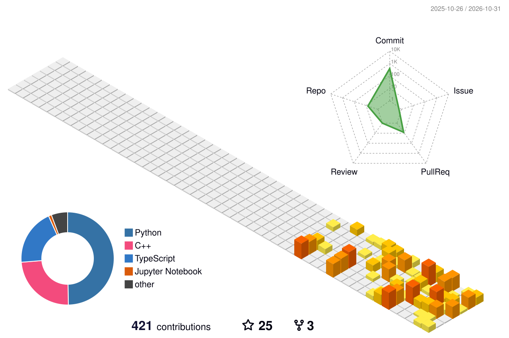

<h1 align="center">
  <samp>
    Hey  I'm Dulnith Liyanage
  </samp>
</h1>

<h3 align="center">
  <samp>ENTC Undergrad @ University of Moratuwa</samp>
</h3>

  

<h3>👨‍💻 About Me</h3>

<table>
  <tr>
    <td valign="top" width="55%">
      <ul>
        <li><samp>🎓 Electronics &amp; Telecommunication Engineering undergrad at the <strong>University of Moratuwa</strong></samp></li>
        <li><samp>🔭 Currently working on <a href="https://github.com/dulnith-liyanage/EcoSort_Smart_Bin">Smart Trash Sorting System</a></samp></li>
        <li><samp>🤖 Trying to understand <strong>machine learning, deep learning &amp; AI agents</strong> from the math up</samp></li>
        <li><samp>🌱 SWE Intern at <a href="https://buildstart.io/">BuildStart</a></samp></li>
        <li><samp>⚡ Fun fact: I'd rather derive it than memorize it</samp></li>
      </ul>
    </td>
    <td valign="top" width="45%">
      
    </td>
  </tr>
</table>

<h3 align="center">🛠️ Tools &amp; Skills</h3>

&nbsp;&nbsp;
&nbsp;&nbsp;
&nbsp;&nbsp;

 
&nbsp;&nbsp;
&nbsp;&nbsp;
&nbsp;&nbsp;

 
&nbsp;&nbsp;
&nbsp;&nbsp;
&nbsp;&nbsp;
&nbsp;&nbsp;
&nbsp;&nbsp;

 
&nbsp;&nbsp;
&nbsp;&nbsp;
&nbsp;&nbsp;
&nbsp;&nbsp;

<h3 align="center">🌌 3D Contribution Calendar</h3>

  <picture>
    <source media="(prefers-color-scheme: dark)" srcset="./profile-3d-contrib/profile-night-rainbow.svg" />
    
  </picture>

<h3 align="center">📊 GitHub Metrics</h3>

  

<h3 align="center">🐍 Contribution Snake</h3>

  <picture>
    <source media="(prefers-color-scheme: dark)" srcset="https://raw.githubusercontent.com/dulnith-liyanage/dulnith-liyanage/output/github-snake-dark.svg" />
    
  </picture>

