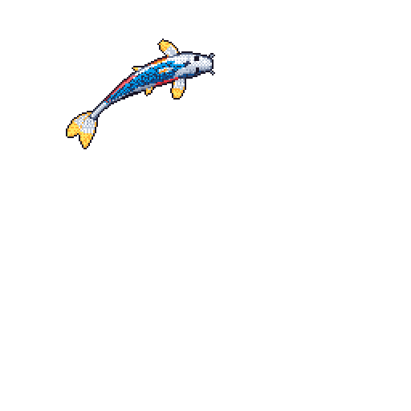
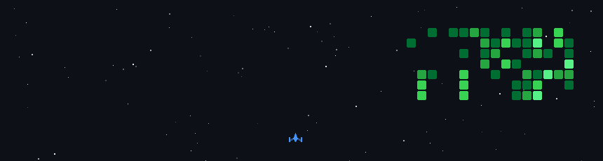

<h1 align="center">
  <samp>
    Hey  I'm Dulnith Liyanage
  </samp>
</h1>

<h3 align="center">
  <samp>ENTC Undergrad @ University of Moratuwa</samp>
</h3>

  

<table>
  <tr>
    <td valign="top" width="55%">

- <samp>🎓 Electronics & Telecommunication Engineering undergrad at the **University of Moratuwa**</samp>
- <samp>🔭 Currently working on [Smart Trash Sorting System](https://github.com/dulnith-liyanage/EcoSort_Smart_Bin)</samp>
- <samp>🤖 Trying to understand **machine learning, deep learning & AI agents** from the math up</samp>
- <samp>🌱 SWE Intern at [BuildStart](https://buildstart.io/)</samp>
- <samp>⚡ Fun fact: I'd rather derive it than memorize it</samp>

    </td>
    <td valign="top" width="45%">
      
    </td>
  </tr>
</table>

 
 

<!-- Tools & Skills + Koi -->
<table align="center" width="100%">
<tr>
<td width="70%" align="center" valign="middle">
<h3>🛠️ Tools & Skills</h3>

&nbsp;&nbsp;
&nbsp;&nbsp;
&nbsp;&nbsp;

 
&nbsp;&nbsp;
&nbsp;&nbsp;
&nbsp;&nbsp;

 
&nbsp;&nbsp;
&nbsp;&nbsp;
&nbsp;&nbsp;
&nbsp;&nbsp;
&nbsp;&nbsp;

 
&nbsp;&nbsp;
&nbsp;&nbsp;
&nbsp;&nbsp;
&nbsp;&nbsp;

</td>
<td width="30%" align="center" valign="middle">

</td>
</tr>
</table>

 

<!-- Space Shooter Contribution Graph -->

  

