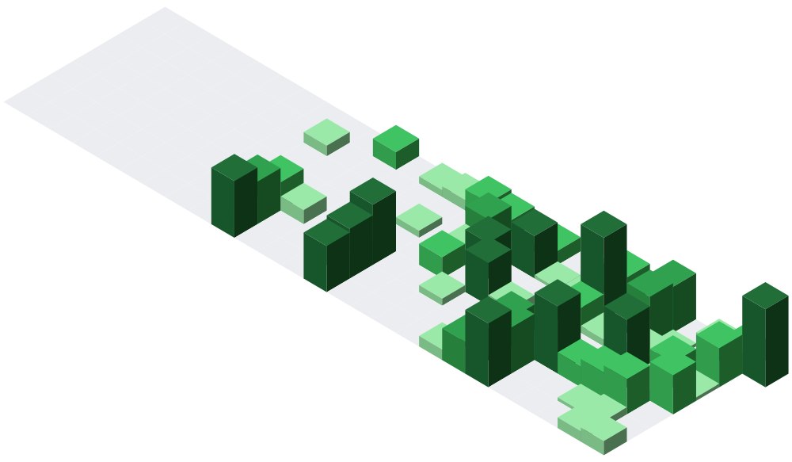

<h1 align="center">
  <samp>Hey  I'm Dulnith Liyanage</samp>
</h1>

<h3 align="center">
  <samp>ENTC Undergrad @ University of Moratuwa</samp>
</h3>

  

---

### 👨‍💻 About Me

<table>
  <tr>
    <td valign="top" width="55%">
      <ul>
        <li>🎓 <strong>Electronics &amp; Telecommunication Engineering</strong> undergraduate at the <strong>University of Moratuwa</strong></li>
        <li>🌱 <strong>Software Engineering Intern</strong> at <a href="https://buildstart.io/"><strong>BuildStart</strong></a></li>
        <li>🤖 Exploring <strong>Edge AI, Computer Vision, and Deep Learning</strong> from mathematical first principles</li>
        <li>⚡ <strong>Engineering Philosophy:</strong> <em>"I'd rather derive it than memorize it."</em></li>
        <li>📍 Based in Bandarawela, Sri Lanka</li>
      </ul>
      

        
        
        
      

    </td>
    <td valign="top" width="45%">
      
    </td>
  </tr>
</table>

---

### 🚀 Featured Engineering Projects

<!-- START_SECTION:featured-projects -->
<table>
  <tr>
    <td width="50%" valign="top">
      <h4>🦯 <a href="https://github.com/Neural-Nexus-IoTrix-2-0/intellicane">Neural-Nexus-IoTrix-2-0/intellicane</a></h4>
      
ESP32-based smart cane for the visually impaired — obstacle and drop-off detection with haptic feedback, AI voice assistant for scene description, and live GPS sharing and cane fall detetion.

      
   

    </td>
    <td width="50%" valign="top">
      <h4>👾 <a href="https://github.com/dulnith-liyanage/desk-companion">desk-companion</a></h4>
      
A Wi-Fi connected ESP32-C3 desktop Yeti with animated OLED expressions, live weather, multiple alarms with on-device manager, Pomodoro timer, endless runner mini-game, and a web dashboard — all controlled via a single capacitive touch sensor.

      
   

    </td>
  </tr>
  <tr>
    <td width="50%" valign="top">
      <h4>♻️ <a href="https://github.com/dulnith-liyanage/EcoSort_Smart_Bin">EcoSort_Smart_Bin</a></h4>
      
Edge AI waste-sorting bin using zero-shot CLIP to classify waste into 4 categories per CMC/Sri Lanka guidelines (paper, plastic, organic, glass/metal), then drives a 2-axis pan-tilt servo arm (Raspberry Pi I2C or Arduino) to dump it in the correct bin — real-time, no training data required.

      
  

    </td>
    <td width="50%" valign="top">
      <h4>📊 <a href="https://github.com/dulnith-liyanage/RetailRadar">RetailRadar</a></h4>
      
A project for Data Odyssey 2026 Inter-University Competition & Exhibition

      
  

    </td>
  </tr>
</table>
<!-- END_SECTION:featured-projects -->

---

<table width="100%">
  <thead>
    <tr>
      <th colspan="2" align="center">🛠️ Technical Arsenal &amp; Engineering Stack</th>
    </tr>
  </thead>
  <tbody>
    <tr>
      <td width="22%" align="left"><b>Embedded &amp; Hardware</b></td>
      <td width="78%">
         &nbsp;
         &nbsp;
         &nbsp;
         &nbsp;
         &nbsp;
         &nbsp;
         &nbsp;
         &nbsp;
         &nbsp;
        
      </td>
    </tr>
    <tr>
      <td width="22%" align="left"><b>AI, ML &amp; Vision</b></td>
      <td width="78%">
         &nbsp;
         &nbsp;
         &nbsp;
         &nbsp;
         &nbsp;
         &nbsp;
         &nbsp;
         &nbsp;
         &nbsp;
        
      </td>
    </tr>
    <tr>
      <td width="22%" align="left"><b>Web, Cloud &amp; Tools</b></td>
      <td width="78%">
         &nbsp;
         &nbsp;
         &nbsp;
         &nbsp;
         &nbsp;
         &nbsp;
         &nbsp;
         &nbsp;
         &nbsp;
         &nbsp;
        
      </td>
    </tr>
  </tbody>
</table>

---

<table width="100%">
  <tr>
    <th width="36%">🗓️ 3D Contribution Landscape</th>
    <th width="64%">📊 Engineering Impact &amp; Activity</th>
  </tr>
  <tr>
    <td valign="middle" align="center" width="36%">
      
    </td>
    <td valign="middle" align="center" width="64%">
      
    </td>
  </tr>
</table>
